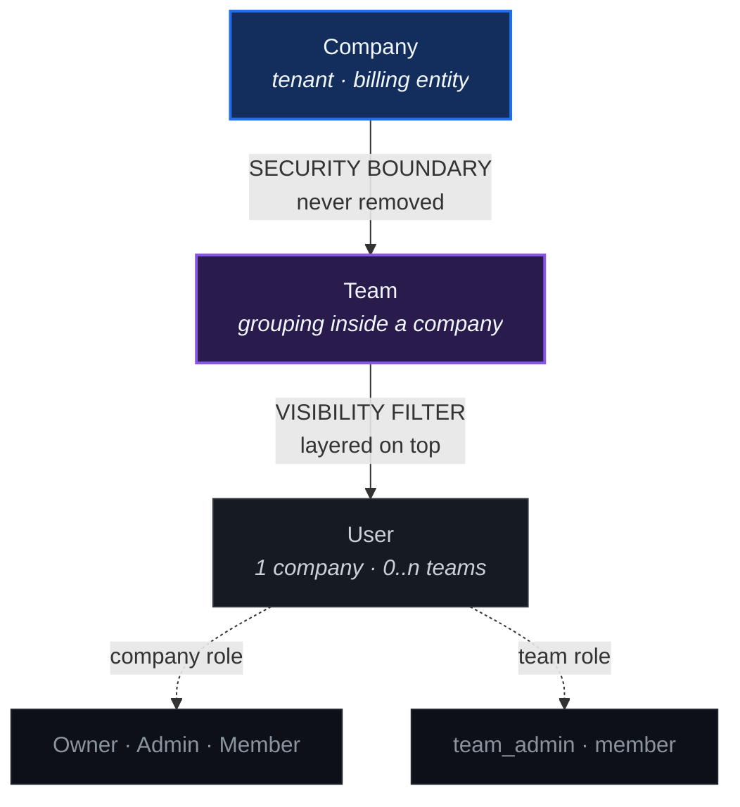
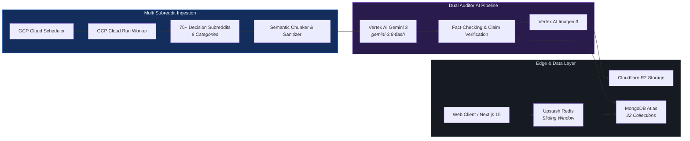
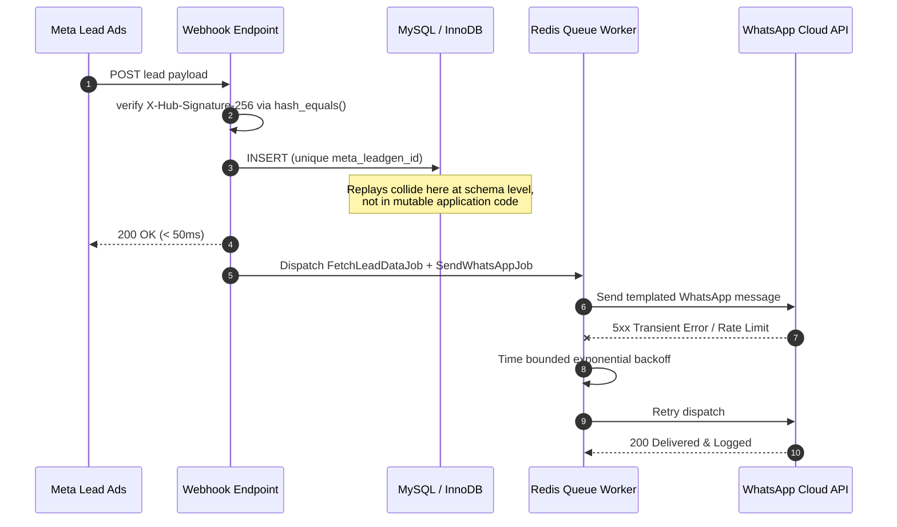
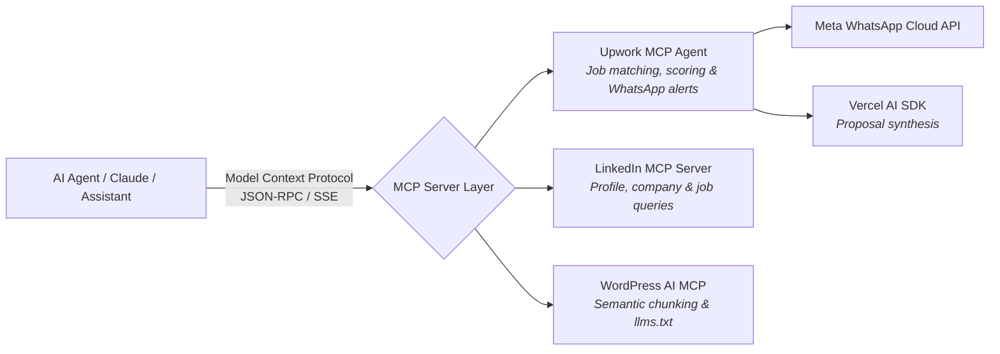

# Adnan Haider

### Senior Backend Engineer &nbsp;·&nbsp; Distributed Queues &nbsp;·&nbsp; Multitenant SaaS &nbsp;·&nbsp; AST Static Analysis

Six years of engineering high throughput backend infrastructure, resilient distributed queues, and multitenant architectures.
Specialized in the load bearing layers of production software: the webhook that cannot return a 502, the queue that must never drop a paid event,
the migration that would take an exclusive table lock at peak traffic, and the static analyzers that keep teams from introducing silent failures.

Founder of **[The Regret Index](https://regretindex.me)** (backed by Google Cloud for Startups & MongoDB for Startups). Author of 11 open source packages. 450+ delivered commercial projects.

 

  

   

---

# Architecture Case Studies

## 1. Multitenant Proposal SaaS

### Turning a delivered single tenant document engine into a zero leak multitenant platform

Originally shipped as a single tenant proposal studio: GrapesJS visual canvas, a ~900 line server renderer, headless Chrome PDF generation via Spatie Browsershot, and cryptographic HMAC sealing. The challenge was converting it into a true multitenant SaaS without compromising security or breaking backward compatibility.

Tenancy is not a database query filter; it is an impenetrable security boundary. Every B2B data leak postmortem reveals the same root cause: someone treated tenant isolation as an optional query scope instead of an architectural invariant that queries cannot escape.

> [!IMPORTANT]
> `CompanyScope` applies **no filter at all** when no tenant resolves in context. That sounds counterintuitive, but it is deliberate so that background workers, migrations, and CLI maintenance commands function seamlessly. It is safe for exactly one architectural reason: `users.company_id` is defined as `NOT NULL`. An authenticated user session can never resolve to null and view global records. Make that column nullable, and the boundary collapses into a critical vulnerability.

### Five Invariants Defended with Automated Tests

| Invariant | System Failure Prevented |
|:--|:--|
| **Scope narrows, never swaps** | Team visibility is built strictly by *layering* on top of company scope, never by replacing it. Prevents cross tenant leaks. |
| **Fails open, deliberately** | Console commands and system queues continue running safely while `users.company_id` remains `NOT NULL`. |
| **Roles are per company** | Spatie's `team_foreign_key` explicitly targets `company_id`. Pointing it at `teams.id` causes permissions to bleed across tenants. |
| **Authorisation self scopes** | `User::can()` automatically binds to the user's active tenant, preventing silent `false` denials inside queues. |
| **Two distinct locale axes** | `users.locale` controls the sender's dashboard chrome; `proposals.locale` governs the legal rendered document (25 locales supported). |

### Concurrency Hardening & Cryptographic Sealing

Proposals become quasi legal contracts the second a client signs. To guarantee immutability:
- **HMAC-SHA256 Document Sealing:** Upon acceptance, the rendered HTML, CSS AST, signature bitmap, and client IP/user agent are serialized and cryptographically hashed with `APP_KEY`. Any manual database alteration invalidates the seal.
- **Queued PDF Pre Warming:** Headless Chrome rendering is isolated to asynchronous background queues (`SendProposalEmailJob`), pre warming the document cache upon status change so public downloads execute in milliseconds without spinning up headless Chrome on the web request thread.

     

---

## 2. [The Regret Index](https://regretindex.me)

### Solo Founder & Platform Architect · Backed by Google Cloud for Startups & MongoDB for Startups

A high scale decision journaling platform that quantifies decision quality, revisits outcomes on an automated schedule, and helps individuals calibrate intuition.

### Architectural Highlights
- **Vertex AI Gemini 3 Migration:** Migrated the core reasoning pipeline from retiring Gemini 2.5 to GA Gemini 3 (`gemini-3.8-flash` for high throughput draft synthesis and `gemini-3.1-flash-image` for multimodal context extraction).
- **Automated Social Signal Ingestion:** Orchestrates GCP Cloud Scheduler and Cloud Run endpoints to systematically ingest and index decision outcomes across 75+ specialized subreddits in 9 categories, bypassing Cloudflare bot challenges through direct service networking.
- **Async Background Polling:** Implemented an asynchronous polling engine with sentence completion safeguards to prevent Cloudflare 524 gateway timeouts on deep analytical drafts up to 8,192 tokens.
- **Edge Storage & Caching:** Automated image synthesis via Vertex AI Imagen 3 with fallback SVG pipelines, stored in Cloudflare R2 and served through an Upstash Redis sliding window rate limiter.

      

---

## 3. Meta Lead Ads to WhatsApp Cloud Engine

### Zero drop webhook ingestion with cryptographic verification & cronless queue draining

Meta does not wait for slow downstream queue workers. If an ingestion endpoint takes longer than a few hundred milliseconds, Meta marks the webhook unhealthy and throttles live advertising campaigns. Real work must never execute on the request thread.

### Key Engineering Decisions
- **Two Independent Integrity Gates:** The HMAC SHA-256 signature verification validates payload authenticity. A unique database index on `meta_leadgen_id` guarantees that webhook replays are rejected by the MySQL storage engine, where race conditions cannot bypass application logic.
- **Cronless Queue Draining (`DrainQueueAfterResponse`):** For environments where system level cron daemons or supervisor instances are restricted, an HTTP terminable middleware triggers background job processing immediately after the fast response is flushed to Meta.
- **Automatic Graph API Pagination:** Built into `PageManager` to transparently fetch high volume ad lead forms with System User token renewal safeguards.
- **Filament 3 Operational Hub:** Admin configurable campaign-to-recipient mappings, round robin lead allocation, and real time session health widgets.

    

---

# Open Source Packages & Developer Tooling

Active packages built to solve structural problems in production and published to Packagist, npm, and GitHub.

<table>
<tr>
<td width="50%" valign="top">
### [supabase-edge-guard](https://github.com/malikad778/supabase-edge-guard)

   

Cross-boundary static security analyzer and Row Level Security (RLS) auditor for Next.js, TanStack Start, Lovable (Vite), and Supabase apps. Correlates TypeScript AST with SQL migrations to catch critical vulnerabilities before deploy.

- 18 high-precision rules (SG001–SG018) detecting cookie spoofing, service_role leaks, SECURITY DEFINER RPCs, unindexed FKs, and RLS gaps
- Automated `--fix` engine generating TypeScript refactors and safe SQL migrations
- Ships with Model Context Protocol (MCP) server, SARIF 2.1.0 reporter, and GitHub Action

`TypeScript AST` &nbsp;`Supabase / Postgres` &nbsp;`RLS Auditor` &nbsp;`MCP Server`
</td>
<td width="50%" valign="top">
### [laravel-queue-guard](https://github.com/malikad778/laravel-queue-guard)

  

Zero-bootstrap static AST security analyzer and reliability linter for Laravel queues, Horizon, and background jobs. Prevents database connection exhaustion, money-losing non-idempotent retries, and race conditions before deploy.

- 9 specialized detectors (QG001–QG009) catching HTTP calls in DB transactions, financial retries, missing SerializesModels, and Horizon timeout drift
- Automated `--fix` safe code transforms and `@queue-safe` granular docblock exemptions
- Standalone CLI, PHPStan 2.x extension, SARIF 2.1.0, and GitHub Action annotations

`AST static analysis` &nbsp;`Laravel Horizon` &nbsp;`Distributed Queues` &nbsp;`PHPStan 2.x`
</td>
</tr>
<tr>
<td width="50%" valign="top">
### [laravel-tenant-guard](https://github.com/malikad778/laravel-tenant-guard)

 

Zero overhead static analysis and AST security scanner for multitenant Laravel SaaS applications. Prevents cross tenant data leaks across database queries, unique validation rules, cache collisions, Filament resources, queued jobs, and route bindings.

- 6 core security rules detecting raw DB queries, cache collisions, unisolated jobs, and unscoped routes
- Emits GitHub Action PR annotations, SARIF v2.1.0, and JSON reports
- Includes standalone zero bootstrap CLI and PHPStan 2.x extension

`AST static analysis` &nbsp;`Multitenant SaaS` &nbsp;`PHPStan 2.x`
</td>
<td width="50%" valign="top">
### [Laravel-migration-guard](https://github.com/malikad778/Laravel-migration-guard)

 

Catches dangerous, table locking, or destructive database migrations in CI before they reach production. The `strong_migrations` equivalent for Laravel. Uses `nikic/php-parser` for AST analysis. Zero configuration required.

- Detects `AddColumnNotNull`, unindexed foreign keys, column type changes, and table drops
- Emits GitHub Action PR annotations, JSON, and CLI reports
- Runtime safety listener intercepts accidental execution

`AST static analysis` &nbsp;`CI safety gate` &nbsp;`nikic/php-parser`
</td>
</tr>
<tr>
<td width="50%" valign="top">
### [php-sentinel](https://github.com/malikad778/php-sentinel)

 

Passive API contract monitoring for strictly typed PHP 8.3+. Silently samples live HTTP payloads via Guzzle middleware, infers deep JSON Schema structures probabilistically, locks a hardened baseline, and alerts when upstream providers introduce breaking schema drift.

- Detects removed fields, type mutations, nullable drift, and enum additions
- Alerts via PSR-3 loggers and PSR-14 events before production code crashes
- Native integrations for Laravel, Symfony, and pure PHP CLI

`PHP 8.3+` &nbsp;`Schema drift detection` &nbsp;`Probabilistic inference`
</td>
<td width="50%" valign="top">
### [nexus-inventory](https://github.com/malikad778/nexus-inventory)

 

Unified, driver based Laravel package for multi channel inventory and catalog synchronization across Shopify, WooCommerce, Amazon SP-API, and Etsy.

- Drop in Composer package with zero third party SaaS dependency
- Custom `AwsV4Signer` implementation for Amazon SP-API compliance
- Token bucket rate limiting preventing channel API quota exhaustion
- Livewire monitoring dashboard with dead letter queue recovery

`Laravel 10 to 12` &nbsp;`Amazon SP-API` &nbsp;`Token bucket` &nbsp;`Webhooks`
</td>
</tr>
<tr>
<td width="50%" valign="top">
### [notification-center](https://github.com/malikad778/notification-center)

 

Enterprise notification microservice and domain package built for Laravel 12 & PHP 8.4. Provides unified dispatching across 7 channels (Email, SMS, Push, Slack, WhatsApp, Reverb WebSockets, Database).

- Dual architecture: Standalone microservice or embeddable domain package
- Intelligent fallback routing: Tripping circuit breakers reroute messages to backup channels
- Custom Laravel Pulse telemetry cards monitoring delivery throughput

`Laravel 12` &nbsp;`PHP 8.4` &nbsp;`Circuit breaker` &nbsp;`Laravel Pulse`
</td>
<td width="50%" valign="top">
### [wp-hook-check](https://github.com/malikad778/wp-hook-check)

 

Static analysis for WordPress hooks. Detects orphaned listeners, unheard hooks, and typo ridden actions/filters by analyzing source code AST directly without booting WordPress.

- Runs fast enough to execute on every pre commit hook
- Detects dynamic hook patterns and generates comprehensive hook maps
- Ships with native WP-CLI package support (`wp hook-check audit`)

`WordPress` &nbsp;`Static analysis` &nbsp;`WP-CLI` &nbsp;`Zero bootstrap`
</td>
</tr>
<tr>
<td width="50%" valign="top">
### [woocommerce-otp-auth-engine](https://github.com/malikad778/woocommerce-otp-auth-engine)

 

Decoupled, high performance authentication and registration engine for WooCommerce and WordPress multisite.

- **3 Phase Transient Pipeline:** Gating registration before database insertion so spam bots never populate `wp_users`
- Multi identifier login (Email, Username, or Verified Phone)
- Defends against SMS pumping & Artificially Inflated Traffic (AIT) fraud
- WooCommerce checkout field locking prevents post auth identity tampering

`WooCommerce` &nbsp;`Fraud defense` &nbsp;`Transient pipeline` &nbsp;`Multisite`
</td>
<td width="50%" valign="top">
### [blade-access](https://github.com/malikad778/blade-access)

 

Static accessibility analyzer for Laravel Blade & Livewire views enforcing 73 WCAG 2.1 AA rules aligned with the European Accessibility Act (EAA).

- Parses Blade template directives without executing the rendering engine
- Ships with a baseline configuration system to prevent CI failure on legacy views
- Zero runtime dependencies

`WCAG 2.1 AA` &nbsp;`EAA compliance` &nbsp;`Blade linter` &nbsp;`Baseline system`
</td>
</tr>
<tr>
<td colspan="2" valign="top">
### [php-vs-go-benchmark](https://github.com/malikad778/php-vs-go-benchmark)

 

Comprehensive concurrency and throughput benchmark comparing modern PHP runtimes (RoadRunner, Swoole, PHP-FPM 8.3) against idiomatic Go under high concurrency.

- Measures p50, p95, p99 latency distributions, memory ceilings, and context switching
- Tests realistic real world workloads: JSON serialization, DB connection pooling, and hashing

`High concurrency` &nbsp;`Performance` &nbsp;`RoadRunner` &nbsp;`Go`
</td>
</tr>
</table>

---

# AI Agents & Model Context Protocol (MCP)

Building production systems that connect LLMs, autonomous agents, and real world tools via the **Model Context Protocol (MCP)**.

### Systems in Production
- **[Job Alert Upwork MCP](https://github.com/malikad778/job-alert-upwork-mcp)**: Full stack monorepo (`@job-radar/web` + `@job-radar/jobs`) connecting directly to Upwork's official MCP server via `@modelcontextprotocol/sdk` and OAuth 2.1 Dynamic Client Registration. Evaluates jobs against strict criteria with a 0 to 100 matching engine, triggers automated proposal generation via the Vercel AI SDK, and delivers alerts to WhatsApp in real time. 100% TOS compliant zero scraping architecture.
- **[LinkedIn MCP Server](https://github.com/malikad778/linkedin-mcp-server)**: Open source MCP server giving AI agents direct tool calling access to professional profiles, companies, jobs, and communication channels. Dockerized with `uv`, Python, and AWS Bedrock support.
- **[WordPress AI MCP](https://github.com/malikad778/ai-mcp)**: Exposes any WordPress site to AI search agents over REST with semantic content chunking, FAQ extraction, media indexing, `llms.txt`, and full MCP manifests.
- **Self Hosted vLLM GPU Cloud Infrastructure**: Automated AWS EC2 lifecycle tooling managing GPU instances running vLLM inference server for open weights models (e.g., Qwen-Coder 30B), optimizing compute costs with automated elastic IP attachment and instance hibernation.

---

# Stealth Automation, Daemons & Extensions

Long running browser automation and system level telemetry engineered for stability, evasion, and zero leak operations.

- **Resilient Session Keepalive Daemon**: Stealth browser automation daemon operating under Linux systemd and Xvfb on AWS EC2. Built with Python, Playwright, and asyncio. Features state machine CAPTCHA resolution, Fernet encrypted session cookie storage, humanized jittered mouse/scroll behavioral simulations, and memory managed Chromium lifecycle recycling.
- **Consular Service Appointment Monitor**: Manifest V3 Chrome extension providing real time visa wait time calculation and tracking directly on diplomatic consular candidate portals with local only DOM parsing and zero external data transmission.
- **Network Telemetry & Fiber Health Monitor**: Multi threaded PowerShell system tray widget running in background STA runspaces with C# P/Invoke. Polls LAN HTTP router diagnostic endpoints to track live optical fiber health (Rx/Tx dBm, optical temperature, line latency) with zero WAN bandwidth impact.

---

# Cross Platform & Commercial Systems

- **Chapter Link Log**: Cross platform web and native iOS application built with TanStack Start (SSR), TanStack Router, TanStack Query, Tailwind CSS v4, Capacitor iOS, and Supabase.
- **[Pure Korea](https://github.com/malikad778/pure-korea)**: Korean skincare e-commerce platform built with Next.js, Firebase Firestore live sitemaps, JSON-LD rich schema markup, and Cloudflare Web Analytics.
- **European SME Enterprise Web Architecture**: Delivered production platforms and bespoke digital systems for precision craftsmanship, gastronomy, and retail businesses across European commercial markets.
- **Client Track Record**: 450+ completed projects across international clients on Upwork, top freelance platforms, and direct enterprise contracts with a verified 5.0★ rating.

---

# Stack

<table>
<tr><td valign="middle"><b>CORE</b></td><td></td></tr>
<tr><td valign="middle"><b>DATA</b></td><td></td></tr>
<tr><td valign="middle"><b>INFRA</b></td><td></td></tr>
<tr><td valign="middle"><b>FRONT</b></td><td></td></tr>
<tr><td valign="middle"><b>AI & MCP</b></td><td></td></tr>
<tr><td valign="middle"><b>TEST</b></td><td></td></tr>
</table>

---

# Engineering Philosophy

**A test that never disagrees with you is decoration.**
Write the test that fails when the invariant breaks, not the one that passes today. In a multitenant system, the tests worth having are the ones that go red the second someone collapses two tenant axes into one.

**Fail loudly at the boundary, gracefully in the middle.**
Reject a malformed payload at ingestion where validation is cheap and full request context exists. The alternative is a half written row three services deep that a customer finds for you next week.

**Write down the deviation and the reason.**
Specifications and plans are always incomplete in places. Six months later, the useful artefact is not the original plan; it is knowing why the implementation diverged and what constraints governed the choice.

**Comments explain why. Code explains what.**
If a block needs a comment to explain what it does, rewrite the block. Reserve comments for non obvious constraints you cannot deduce from syntax, such as an upstream provider bug that presents as an auth timeout.

---

### Laravel · PHP · Distributed Queues · Multitenant SaaS · AI & MCP Infrastructure

Based in Pakistan &nbsp;·&nbsp; Working remotely with teams worldwide

**[adnanhaider0347@gmail.com](mailto:adnanhaider0347@gmail.com)** &nbsp;·&nbsp; **[codebyadnan.tech](https://codebyadnan.tech)** &nbsp;·&nbsp; **[LinkedIn](https://www.linkedin.com/in/adnan-haider/)** &nbsp;·&nbsp; **[The Regret Index](https://regretindex.me)**

